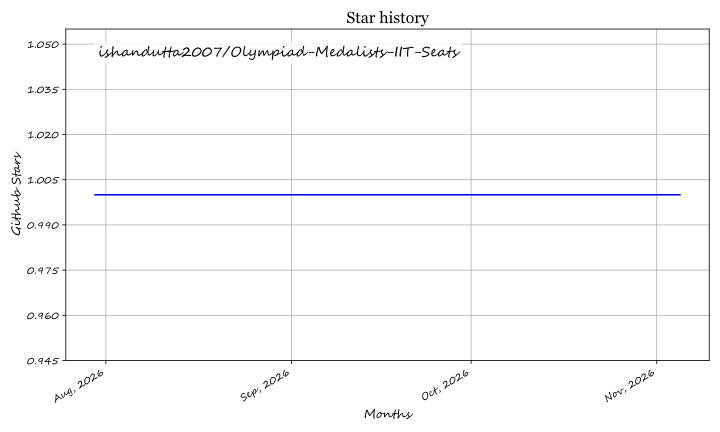

# IIT Direct Admission Seats for Olympiad Medalists & Campers (2026–2027)

Comprehensive guide and tracked data on **direct admission and supernumerary seat quotas in Indian Institutes of Technology (IITs)** for International Science Olympiad medalists and National Olympiad Training Camp qualifiers without needing JEE Advanced ranks.

---

## 📌 Overview & Eligibility

Several premier Indian Institutes of Technology (IITs)—including IIT Kanpur, IIT Madras, IIT Kharagpur, IIT Mandi, IIT Gandhinagar, and IIT Bombay—have introduced **supernumerary quota seats** and direct admission channels for students representing India in prestigious International Olympiads, as well as students qualifying for national orientation-cum-selection camps.

### Covered Olympiads
* **IMO** — International Mathematical Olympiad (IMOTC qualifiers / INMO awardees)
* **IOI** — International Olympiad in Informatics (IOITC qualifiers / INOI awardees)
* **IPhO** — International Physics Olympiad (OCSC Physics)
* **IChO** — International Chemistry Olympiad (OCSC Chemistry)
* **IBO** — International Biology Olympiad (OCSC Biology)

---

## 🏛️ IIT Supernumerary Seat Matrix (2026–2027)

The table below outlines the calculated supernumerary seat capacities for International Olympiad medalists and training camp qualifiers across participating Indian Institutes of Technology (IITs).

| IIT Name | Mathematics Olympiad (IMO / IMOTC) | Informatics Olympiad (IOI / IOITC) | Chemistry Olympiad (IChO / OCSC) | Biology Olympiad (IBO / OCSC) | Physics Olympiad (IPhO / OCSC) |
| :--- | :--- | :--- | :--- | :--- | :--- |
| **IIT Kanpur** | **7 Seats**  *(4 in Math Dept, 3 in Economics)* | **6 Seats**  *(Computer Science Dept)* | **2 Seats**  *(Chemistry Dept)* | **2 Seats**  *(Bio Sciences Dept)* | **—** |
| **IIT Madras** | **34 Seats**  *(2 seats per program across 17 branches)* | **34 Seats**  *(2 seats per program across 17 branches)* | **34 Seats**  *(2 seats per program across 17 branches)* | **34 Seats**  *(2 seats per program across 17 branches)* | **34 Seats**  *(2 seats per program across 17 branches)* |
| **IIT Kharagpur** | **34 Seats**  *(2 seats per program across 17 branches)* | **34 Seats**  *(2 seats per program across 17 branches)* | **34 Seats**  *(2 seats per program across 17 branches)* | **34 Seats**  *(2 seats per program across 17 branches)* | **34 Seats**  *(2 seats per program across 17 branches)* |
| **IIT Mandi** | **34 Seats**  *(2 seats per program across 17 branches)* | **34 Seats**  *(2 seats per program across 17 branches)* | **34 Seats**  *(2 seats per program across 17 branches)* | **34 Seats**  *(2 seats per program across 17 branches)* | **34 Seats**  *(2 seats per program across 17 branches)* |
| **IIT Gandhinagar** | **12 Seats**  *(2 seats per program across 6 B.Tech branches)* | **12 Seats**  *(2 seats per program across 6 B.Tech branches)* | **12 Seats**  *(2 seats per program across 6 B.Tech branches)* | **—** | **12 Seats**  *(2 seats per program across 6 B.Tech branches)* |
| **IIT Bombay** | **2 Seats**  *(Estimated for BS Mathematics)* | **—** | **—** | **—** | **—** |
| **ROW TOTAL** | **123 Seats** | **120 Seats** | **116 Seats** | **106 Seats** | **114 Seats** |

> [!NOTE]
> **Virtual Pool Capacities:** These figures represent maximum theoretical supernumerary caps allowed by individual institute ordinances. Seats are created on-demand only for eligible applicants who qualify through respective standalone evaluation criteria and interviews.

---

## 🔍 Key Insights & Analysis

Summing up each column yields 500+ theoretical seats, but in reality, only 20–30 students represent India internationally each year across all science and informatics Olympiads. Approximately half often choose to pursue undergraduate studies overseas (MIT, Stanford, Oxford, Cambridge, etc.), leaving around 10–15 students opting for domestic admissions.

Consequently, supernumerary seat channels practically ensure that **any student who represents India internationally is guaranteed admission into an IIT**.

### Future Action Items & Recommendations
* **Extend to Training Camp Qualifiers:** If all students who qualify for national training camps (~150–200 students per year) are assured IIT seats, India's performance on international stages could improve dramatically by removing the high opportunity cost of stepping away from JEE Advanced preparation.
* **Pan-IIT Adoption:** Broadening supernumerary seat capacities across all 23 IITs for both International Olympiad medalists and OCSC/IMOTC/IOITC camp qualifiers would foster elite STEM talent development in India.

---

## 👥 National Olympiad Training Camp Pool Summary

| Subject Channel | Camp Name | Administering Body | Number of Campers | Final Int'l Team Size |
| :--- | :--- | :--- | :--- | :--- |
| **Mathematics** | IMOTC (International Mathematical Olympiad Training Camp) | HBCSE / TIFR / NBHM | **~70 students** | 6 students |
| **Informatics** | IOITC (International Olympiad in Informatics Training Camp) | IARCS | **~36 students** | 4 students |
| **Physics** | OCSC (Orientation-cum-Selection Camp - Physics) | HBCSE / TIFR | **~35 students** | 5 students |
| **Chemistry** | OCSC (Orientation-cum-Selection Camp - Chemistry) | HBCSE / TIFR | **~35 students** | 4 students |
| **Biology** | OCSC (Orientation-cum-Selection Camp - Biology) | HBCSE / TIFR | **~35 students** | 4 students |
| **TOTAL POOL** | | | **~211 Students** | **23 Students** |

---

## ❓ Frequently Asked Questions (FAQ)

### Do Olympiad medalists need to appear for JEE Advanced?
Many IITs with formal Olympiad direct admission programs (such as IIT Kanpur and IIT Madras) evaluate candidates based on their Olympiad performance, internal written tests, and faculty interviews rather than their standard JEE Advanced rank.

### Which subjects are eligible for direct IIT admission?
Currently, eligible subjects include Mathematics (IMO), Informatics/Computer Science (IOI), Physics (IPhO), Chemistry (IChO), and Biology (IBO). Branch allocations generally correspond to relevant disciplines or departments offering supernumerary seats.

---

## ⭐ Star History

<a href="https://star-history.com/#ishandutta2007/Olympiad-Medalists-IIT-Seats&Timeline" align="center">
  <picture>
    <source media="(prefers-color-scheme: dark)" srcset="assets/ishandutta2007_Olympiad-Medalists-IIT-Seats_growth.svg">
    
  </picture>
</a>
